# Design and Full-Custom Implementation of a 4-Bit NOR-Type Ternary Content-Addressable Memory (TCAM) Word in Cadence Virtuoso (45 nm)

## 1. Project Overview

This repository documents the transistor-level design of a **4-bit NOR-type Ternary Content-Addressable Memory (TCAM) word** in Cadence Virtuoso using the gpdk045 (45 nm) CMOS technology at a supply voltage of **0.9 V**.

A TCAM stores three states per bit (`0`, `1` and `X`, meaning don't care) and compares a stored word against an input search word. In a NOR-type word, all cells share one precharged match line (ML). The ML stays high only if every unmasked bit matches, and any mismatching bit discharges it.

The design was developed hierarchically, from a gate-level reference model to transistor-level storage, comparison and sensing circuits.

### 1.1 Scope and Status

| Item | Status |
|---|---|
| Gate-level reference model (mask control + NOR-4) | Completed and verified for three vectors |
| 6T SRAM cell | Completed; write 0, write 1 and hold verified |
| 16T NOR-type ternary cell | Schematic complete; one test case simulated (stored 1, searched 1) |
| 4-bit TCAM row with shared match line | Schematic complete; exact-match and single-bit-mismatch cases simulated |
| Latch-type sense amplifier | Schematic complete; one input polarity simulated; known limitations (Section 9.5) |
| Multi-word (4-word) array, write decoder, priority encoder | Not part of the transistor-level results reported here |
| Layout, parasitic extraction, delay and power characterization | Not performed |

This repository therefore presents **one 4-bit TCAM word**, not a 4-word array. A gate-level 4-word organization with 6T storage, a write decoder and a priority encoder is under development and is not part of the results below.

### 1.2 Design Hierarchy

- **Gate-level reference model:** ideal logic gates (XOR, AND, inverter, OR, NOR-4) used as the functional golden reference.
- **6T SRAM cell:** the static storage element. Two are used per TCAM bit (nodes `Q1` and `Q2`).
- **16T NOR-type TCAM cell:** two 6T SRAM cells plus four NMOS transistors forming two series compare stacks on the match line.
- **4-bit TCAM row:** four 16T cells sharing the match line `ML`, the word line `WL` and a PMOS precharge device.
- **Latch-type sense amplifier:** a differential cross-coupled amplifier connected to the match line.

## 2. Technology and Design Tools

| Item | Detail |
|---|---|
| Technology | gpdk045 (45 nm CMOS) |
| Devices | `nmos1v` (g45n1svt) and `pmos1v` (g45p1svt), L = 45 nm |
| Supply voltage | VDD = 0.9 V (all simulations) |
| Design entry | Cadence Virtuoso Schematic Editor |
| Simulation | Spectre transient analysis (ADE) |
| Waveform viewer | Virtuoso Visualization and Analysis (ViVA) |
| Output loads | 5 fF capacitors on the sense amplifier outputs `MATCH` and `MATCH_B` |

No explicit capacitor is drawn on the match line itself. Its capacitance is that of the connected device terminals only.

## 3. Architecture

The 4-bit TCAM word consists of four 16T cells sharing a single match line. A PMOS transistor (W = 480 nm, gate `PRE_B`) precharges `ML` to VDD before each search. During the search, each cell's compare network either leaves `ML` high (match) or discharges it (mismatch). The match line is connected to the `IN` pin of the latch-type sense amplifier, which is intended to regenerate the match-line level into a digital `MATCH` signal.


*Figure 1. Architecture of the 4-bit NOR-type TCAM word.*

## 4. Flow of Implementation

1. Gate-level functional reference (XOR-AND mask control and NOR-4).
2. 6T SRAM cell design and verification.
3. 16T ternary cell (two 6T SRAM cells and four compare NMOS transistors).
4. 1-bit cell test.
5. 4-bit TCAM row with a shared match line.
6. Latch-type match-line sense amplifier.

## 5. Gate-Level Reference Model

The gate-level model is the functional reference for the TCAM word. It models the per-bit comparison, the don't-care masking and the word-level match using ideal gates.

### 5.1 Per-Bit Mask Control

For each bit, with stored data `D`, search bit `S` and mask `M`:

$$X_i = D_i \oplus S_i, \qquad MM_i = X_i \cdot \overline{M_i}$$

- `M = 0`: the bit is compared. If `D` differs from `S`, `MM = 1` (mismatch).
- `M = 1`: the bit is masked (don't care) and `MM = 0` regardless of `D` and `S`.

| M | D ⊕ S | MM (mismatch) | State |
|---|---|---|---|
| 0 | 0 | 0 | Compared, equal |
| 0 | 1 | 1 | Compared, different |
| 1 | 0 | 0 | Masked |
| 1 | 1 | 0 | Masked |

### 5.2 NOR-4 Word Combiner

$$MATCH = \overline{MM_0 + MM_1 + MM_2 + MM_3}$$

`MATCH` is high only when all four mismatch signals are 0.

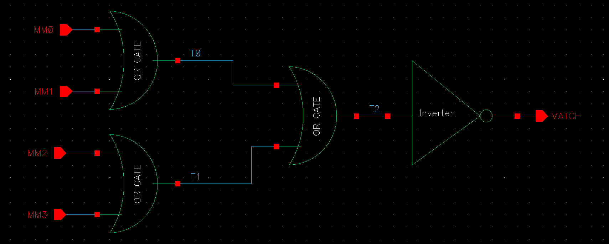

*Figure 2. NOR-4 word combiner schematic (three OR gates and an inverter).*

The NOR-4 block was simulated with four inputs `A`, `B`, `C`, `D` forming a binary counting pattern (periods of 20, 40, 80 and 160 ns, all starting at 10 ns). `MATCH` is high only when all four inputs are low: at 0–10 ns, 160–170 ns, 320–330 ns and 480–490 ns, which agrees with the expected behavior.

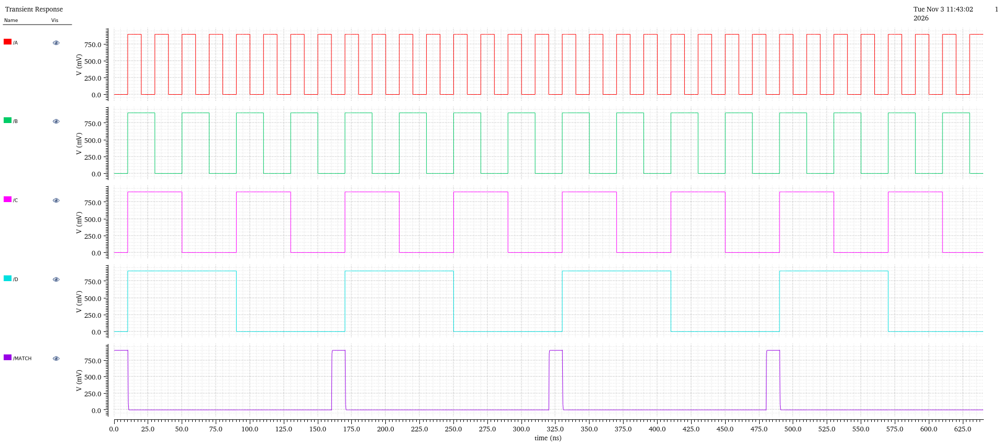

*Figure 3. Transient waveform of the NOR-4 combiner.*

### 5.3 Top-Level 4-Bit Gate-Level TCAM

Four mask-control units drive the NOR-4 combiner. The inputs are `D[3:0]`, `M[3:0]` and `S[3:0]`, and the output is `MATCH`.

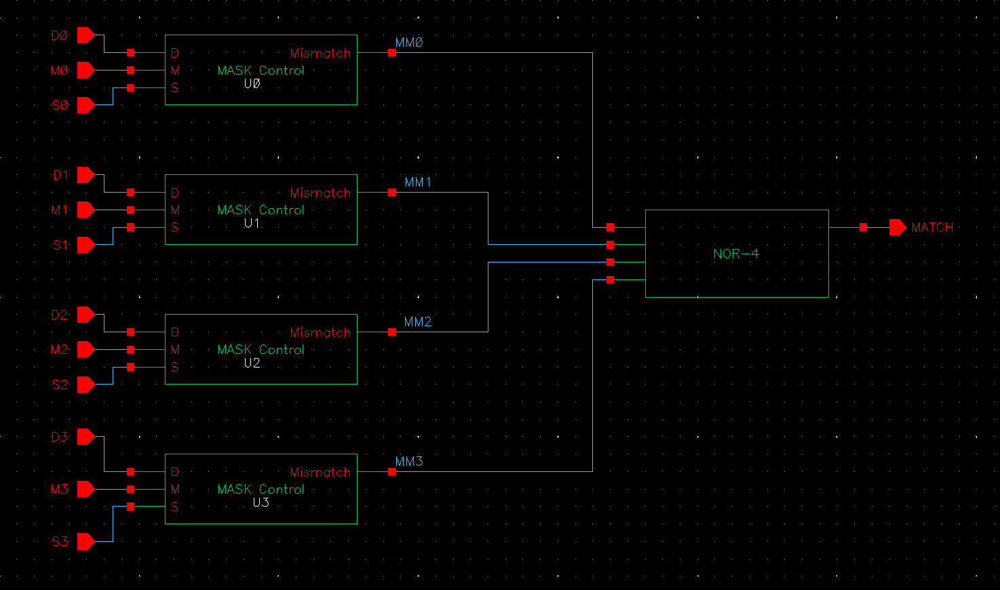

*Figure 4. Top-level 4-bit gate-level TCAM reference model.*

| Case | D | M | S | Expected MATCH | Simulated MATCH |
|---|---|---|---|---|---|
| Exact match | 1010 | 0000 | 1010 | 1 | about 0.9 V |
| Masked mismatch (don't care) | 1010 | 0001 | 1011 | 1 | about 0.9 V |
| Unmasked mismatch (bit 1) | 1010 | 0000 | 1000 | 0 | about 43 nV (logic 0) |

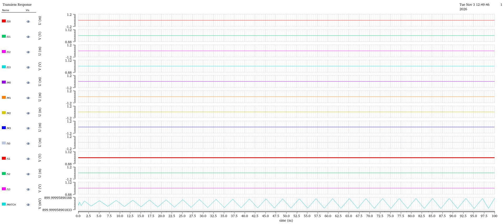

*Figure 5. Exact match.*


*Figure 6. Masked (don't-care) mismatch.*

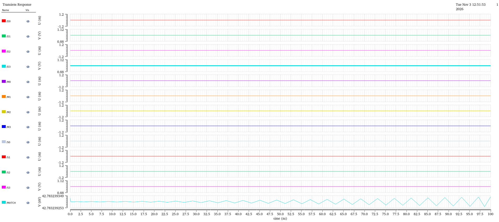

*Figure 7. Unmasked mismatch.*

Note: in this model, `D` and `M` are DC inputs. The model verifies the match function but does not store data.

## 6. 6T SRAM Cell

### 6.1 Circuit

The storage core consists of two cross-coupled inverters (`PM1`/`NM1` and `PM2`/`NM2`) and two NMOS access transistors (`A1`, `A2`) controlled by `WL`. In the implemented cell, each of the outputs `Q` and `QB` is passed through a two-inverter buffer, so the compare transistors of the TCAM cell load the buffer instead of the storage nodes.

| Device | Role | W / L |
|---|---|---|
| PM1, PM2 | Pull-up PMOS | 180 nm / 45 nm |
| NM1, NM2 | Pull-down NMOS | 360 nm / 45 nm |
| A1, A2 | Access NMOS | 250 nm / 45 nm |
| Output buffers | Two inverters each on Q and QB | Inverter sub-cells |

The pull-down to access ratio is 360/250 = 1.44, and the pull-up to access ratio is 180/250 = 0.72.

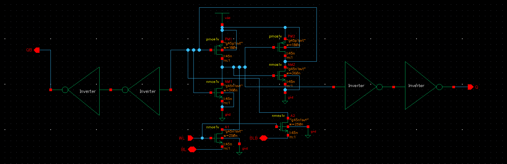

*Figure 8. 6T SRAM cell schematic with buffered outputs.*

### 6.2 Operation

- **Hold (`WL` = 0):** the access transistors are off and the cross-coupled inverters retain the stored value.
- **Write (`WL` = 1):** `BL` and `BLB` are driven to complementary levels and overpower the cell through the access transistors.
- **Read:** conventional bit-line read is not exercised, because the TCAM uses `Q` and `QB` only as gate inputs of the compare stacks. Read stability was not simulated.

### 6.3 Test Conditions

| Signal | V1 (V) | V2 (V) | TD (ns) | TR / TF (ns) | PW (ns) | PER (ns) |
|---|---:|---:|---:|---:|---:|---:|
| WL | 0 | 0.9 | 10 | 0.1 | 10 | 20 |
| BL | 0.9 | 0 | 5 | 0.1 | 20 | 40 |
| BLB | 0 | 0.9 | 5 | 0.1 | 20 | 40 |

`BL` and `BLB` are exact complements, and their edges (5, 25, 45 ns and so on) are always at least 5 ns away from the `WL` edges, so data never changes at the same time as a word-line edge. The simulation runs to 250 ns.

### 6.4 Results

`Q` changes only when `WL` is high and follows `BL`. It holds its value while `WL` is low, including when `BL` and `BLB` change. `Q` and `QB` are complementary and swing between about 0 V and about 0.9 V. Write 0, write 1 and hold are all demonstrated.

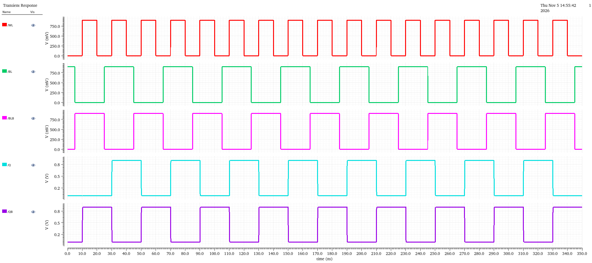

*Figure 9. Transient waveform of the 6T SRAM cell.*

## 7. Latch-Type Match-Line Sense Amplifier

### 7.1 Topology

| Device | Role | W / L |
|---|---|---|
| N1 (M_IN1) | Input transistor, gate `IN` | 360 nm / 45 nm |
| N3 (M_IN2) | Reference transistor, gate `VREF` | 360 nm / 45 nm |
| N2 | Tail switch, gate `SA_EN` | 600 nm / 45 nm |
| N4, N5 (M_N1, M_N2) | Cross-coupled NMOS latch, sources to ground | 1.2 µm / 45 nm |
| P1, P2 (M_P1, M_P2) | Cross-coupled PMOS latch | 960 nm / 45 nm |
| P3, P4 | Reset PMOS, gate `SA_EN`, drains on the outputs | 600 nm / 45 nm |

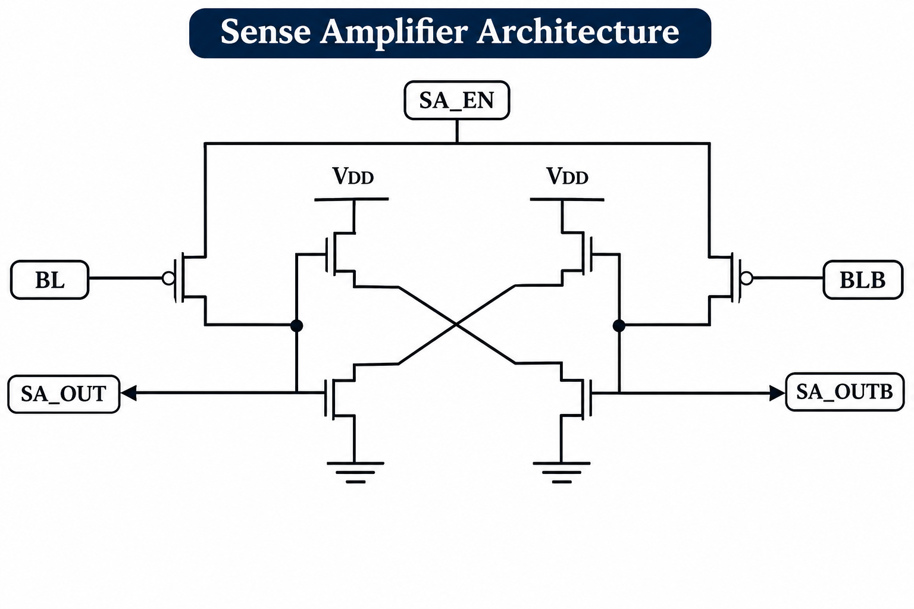

*Figure 16. Structure of the latch-type sense amplifier.*

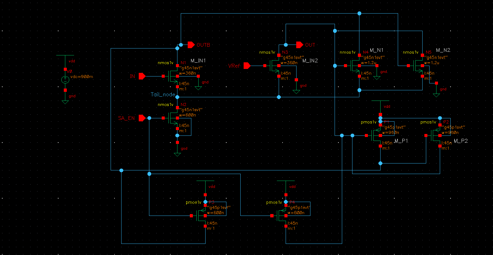

*Figure 17. Transistor-level schematic of the sense amplifier.*

### 7.2 Pin Definition

| Pin | Direction | Function |
|---|---|---|
| IN | Input | Match line `ML` |
| VREF | Input | Static reference voltage |
| SA_EN | Input | Enable / clock |
| OUT (`MATCH`) | Output | Positive output |
| OUTB (`MATCH_B`) | Output | Complementary output |

### 7.3 Intended Operation

1. **Reset (`SA_EN` = 0):** the reset PMOS devices pull both outputs toward VDD and the tail switch is off.
2. **Evaluation (`SA_EN` = 1):** the tail switch turns on, the input pair develops a difference according to `IN` relative to `VREF`, and the cross-coupled latch regenerates it so that one output goes high and the other low.

### 7.4 Test Conditions and Results

| Signal | Value |
|---|---|
| IN | DC, about 0.85 V |
| VREF | DC, 0.75 V |
| SA_EN | V1 = 0, V2 = 0.9 V, TD = 10 ns, PW = 20 ns, PER = 40 ns |
| Stop time | 100 ns |

| Phase | OUT | OUTB |
|---|---|---|
| Before first enable (t < 10 ns) | about 0.66 V | about 0.68 V |
| `SA_EN` high | about 0.82 V | about 0.02 V |
| `SA_EN` low (after first evaluation) | about 0.83 V | about 0.10 V |

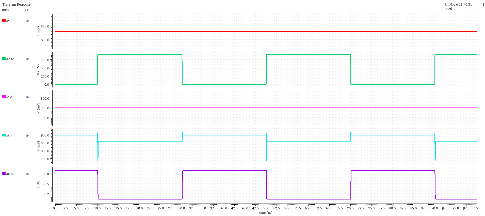

*Figure 18. Sense amplifier transient waveform with IN above VREF.*

### 7.5 Observations and Limitations

1. **Correct decision for one polarity.** With `IN` above `VREF`, `OUT` goes high and `OUTB` goes low when `SA_EN` rises, and the result repeats each cycle.
2. **Outputs are not full swing.** `OUT` reaches only about 0.82 V (supply 0.9 V), and `OUTB` does not reach exactly 0 V.
3. **Reset is incomplete.** With `SA_EN` low, the outputs do not return to VDD and the amplifier keeps its previous decision. The sources of the cross-coupled NMOS transistors (N4, N5) are connected directly to ground, so the latch is always active, and the 600 nm reset PMOS devices cannot overcome the 1.2 µm latch NMOS devices.
4. **Only one input polarity was simulated.** The reverse case (`IN` below `VREF`), a sequence in which `IN` changes between cycles, and the minimum resolvable input difference have not been tested.
5. **The row-level results in this repository are match-line waveforms.** The sense amplifier output behavior for the integrated row is not reported.


## 8. 16T NOR-Type Ternary Cell

### 8.1 Topology

Each ternary cell contains:

- two 6T SRAM cells, storing `Q1` and `Q2` (sharing `WL`, each with its own bit-line pair `BL1`/`BLB1` and `BL2`/`BLB2`);
- two series NMOS compare stacks between `ML` and ground, each with W = 240 nm and L = 45 nm:
  - **Stack A:** `N1` (gate `SL`) in series with `N2` (gate `Q1`);
  - **Stack B:** `NM1` (gate `SLB`) in series with `NM3` (gate `Q2`).

The `QB` outputs of both SRAM cells are not used. The total transistor count is 2 × 6 + 4 = 16, plus the buffer inverters inside the SRAM sub-cells.

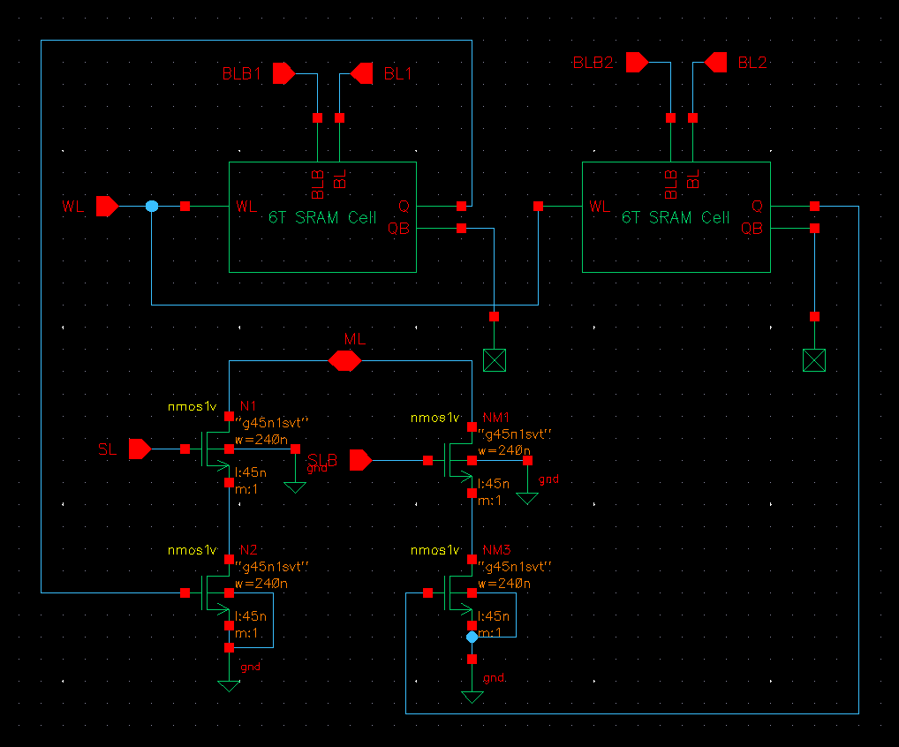

*Figure 10. Schematic of the 16T ternary cell.*

### 8.2 Ternary Storage Encoding

With data `D` and mask `M` (`M = 1` means don't care):

$$Q_1 = \overline{D}\cdot\overline{M}, \qquad Q_2 = D\cdot\overline{M}$$

| Stored value | Q1 | Q2 | Write levels during `WL` high: BL1 / BLB1 / BL2 / BLB2 |
|---|---|---|---|
| 0 | 1 | 0 | 0.9 V / 0 V / 0 V / 0.9 V |
| 1 | 0 | 1 | 0 V / 0.9 V / 0.9 V / 0 V |
| X | 0 | 0 | 0 V / 0.9 V / 0 V / 0.9 V |
| Invalid | 1 | 1 | Not used |

Search-line encoding:

| Search key | SL | SLB |
|---|---|---|
| 0 | 0 V | 0.9 V |
| 1 | 0.9 V | 0 V |
| X (global mask) | 0 V | 0 V |

### 8.3 Compare Operation

A stack conducts, and discharges `ML`, only when both of its gates are high.

| Stored | Search 0 | Search 1 | Search X |
|---|---|---|---|
| 0 | Match (ML high) | Mismatch (Stack A on) | Match |
| 1 | Mismatch (Stack B on) | Match (ML high) | Match |
| X | Match | Match | Match |

### 8.4 Test of the 1-Bit Cell

The cell was tested in two phases: a write phase (`WL` pulse with write bit lines) and a search phase (`SL`/`SLB` pulses), with `ML` precharged beforehand by `PRE_B`. Tested case: stored `D = 1`, search `S = 1`, which should leave `ML` high.

| Signal | V1 (V) | V2 (V) | TD (ns) | TR / TF (ns) | PW (ns) | PER (ns) |
|---|---:|---:|---:|---:|---:|---:|
| PRE_B | 0.9 | 0 | 2 | 0.1 | 8 | 50 |
| WL | 0 | 0.9 | 12 | 0.1 | 10 | 50 |
| BL1 | 0.9 | 0 | 12 | 0.1 | 10 | 50 |
| BLB1 | 0 | 0.9 | 12 | 0.1 | 10 | 50 |
| BL2 | 0 | 0.9 | 12 | 0.1 | 10 | 50 |
| BLB2 | 0.9 | 0 | 12 | 0.1 | 10 | 50 |
| SL | 0 | 0.9 | 28 | 0.1 | 16 | 50 |
| SLB | 0.9 | 0 | 28 | 0.1 | 16 | 50 |

Result: `ML` remains high, which is a match.

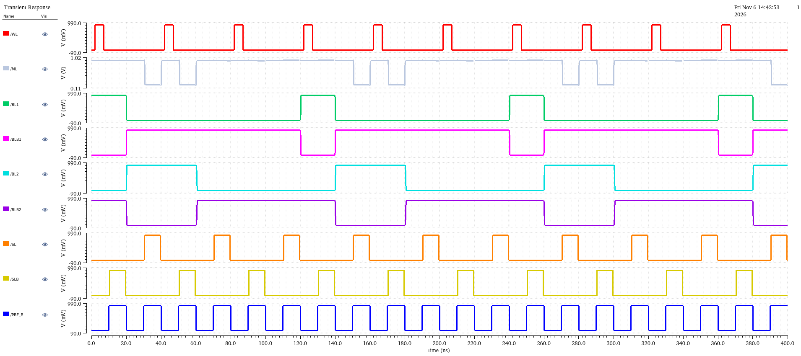

*Figure 11. Transient waveform of the 16T ternary cell.*

Only this single case (stored 1, searched 1) has been simulated for the cell.

## 9. 4-Bit TCAM Row

### 9.1 Implementation

Four 16T cells are connected side by side. They share the match line `ML`, the word line `WL` and the precharge signal `PRE_B`. Each cell has its own write bit lines (`BL1_i`, `BLB1_i`, `BL2_i`, `BLB2_i`) and search lines (`SL_i`, `SLB_i`). `ML` is also connected to the input of the sense amplifier. The row produces a match only when all four stored bits match the search bits (or are masked).


*Figure 12. Schematic of the 4-bit TCAM row with the sense amplifier.*

### 9.2 Test Conditions

| Signal | V1 (V) | V2 (V) | TD (ns) | TR / TF (ns) | PW (ns) | PER (ns) |
|---|---:|---:|---:|---:|---:|---:|
| PRE_B | 0.9 | 0 | 2 | 0.1 | 8 | 60 |
| WL | 0 | 0.9 | 12 | 0.1 | 10 | 60 |

The write bit-line pulses follow the `WL` timing and the search-line pulses follow the 1-bit cell test (TD = 28 ns, PW = 16 ns), with a 60 ns period. Bit-line and search-line levels for each stored value and search key are given in Section 7.2.

### 9.3 Test Case 1: Exact Match

Stored `D = 1010` and search `S = 1010`. All bits match, so `ML` stays high.

| Bit | Stored | BL1 / BLB1 / BL2 / BLB2 (write) | Search | SL / SLB |
|:---:|:---:|:---:|:---:|:---:|
| 3 | 1 | 0 / 0.9 / 0.9 / 0 V | 1 | 0.9 / 0 V |
| 2 | 0 | 0.9 / 0 / 0 / 0.9 V | 0 | 0 / 0.9 V |
| 1 | 1 | 0 / 0.9 / 0.9 / 0 V | 1 | 0.9 / 0 V |
| 0 | 0 | 0.9 / 0 / 0 / 0.9 V | 0 | 0 / 0.9 V |

Result: match.


*Figure 13. Match condition.*

### 9.4 Test Case 2: Mismatch

Stored `D = 1010` and search `S = 1000`. Bit 1 differs (stored 1, searched 0), so Stack B of cell 1 conducts and `ML` discharges.

Result: mismatch.


*Figure 14. Mismatch condition.*

### 9.5 Complete Search Operation

The complete simulation shows the write operation followed by the search operation over multiple cycles. `ML` stays high for the match case and discharges for the mismatch case.

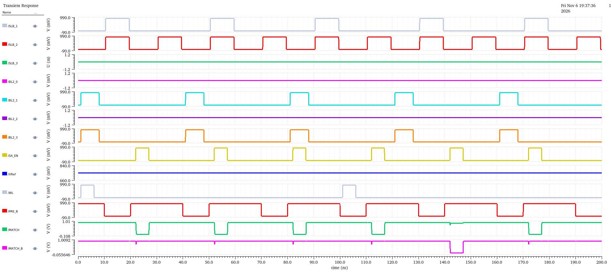

*Figure 15. Write and search operations of the 4-bit row.*

## 10. Summary of Verification

| Block | Verified | Not yet verified |
|---|---|---|
| Gate-level model | Exact match, masked mismatch, unmasked mismatch | Exhaustive vectors |
| 6T SRAM | Write 0, write 1, hold | Read stability, corners |
| 16T cell | Stored 1, searched 1 | Other stored/search combinations, stored X |
| 4-bit row | Exact match, one-bit mismatch | Stored X, masked mismatch, mismatch in each bit position |
| Sense amplifier | IN above VREF | Reverse polarity, reset, full swing, sensitivity |

No comparison between the transistor-level row and the gate-level reference model has been carried out yet. Delay, power and corner simulations have not been performed.

## 11. Future Work

1. Correct the sense amplifier (latch footer and output buffers) and complete its tests.
2. Simulate all stored and search combinations of the 16T cell, including `X`.
3. Apply identical vectors to the gate-level model and the transistor-level row, and compare the results.
4. Complete the 4-word array with a write decoder, bit-line drivers and a priority encoder.
5. Characterize search delay, power and process corners.
6. Layout, design-rule and layout-versus-schematic checks, and post-layout extraction.

## 12. Conclusion

A 4-bit NOR-type TCAM word has been designed at the transistor level in 45 nm CMOS at 0.9 V. The 6T SRAM cell stores and holds data correctly. Two 6T cells and four compare transistors form a 16T ternary cell, and four such cells share a precharged match line. The gate-level reference model verifies the intended match function. The transistor-level verification is currently limited to a small set of cases, and the sense amplifier has known reset and output-swing limitations that must be corrected. The multi-word array, layout and post-layout characterization remain future work.

## 13. Repository Structure

```text
4-Bit-NOR-Type-TCAM/
│
├── README.md
│
└── images/
    ├── architecture.png
    ├── sense_amp_architecture.png
    │
    ├── gate_level_model/
    │   ├── nor_4bit_schematic.png
    │   ├── nor-4_waveform.png
    │   ├── tcam_4bit_reference_model.png
    │   ├── tcam_exact_match.png
    │   ├── tcam_dont-care.png
    │   └── tcam_mismatch.png
    │
    ├── sram_6t/
    │   ├── sram_6t_schematic.png
    │   └── sram_6t_waveform.png
    │
    ├── tcam_1bit/
    │   ├── tcam_1bit_schematic.png
    │   └── tcam_1bit_waveform.png
    │
    ├── tcam_4bit_row/
    │   ├── tcam_row_schematic.png
    │   ├── tcam_row_waveform1.png
    │   ├── tcam_row_waveform2.png
    │   └── tcam_row_waveform3.png
    │
    └── sense_amplifier/
        ├── sense_amp_schematic.png
        └── sense_amp_waveform1.png
```

## 14. Author

**Pranjal Upadhyay**
Roll Number: 523EC0012
Department of Electronics and Communication Engineering
Indian Institute of Information Technology, Design and Manufacturing, Kurnool
