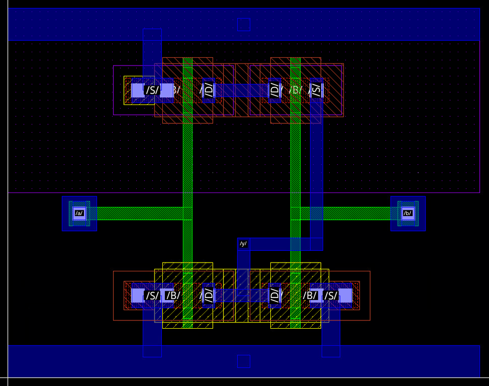
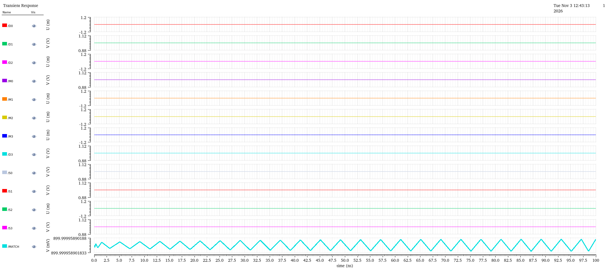
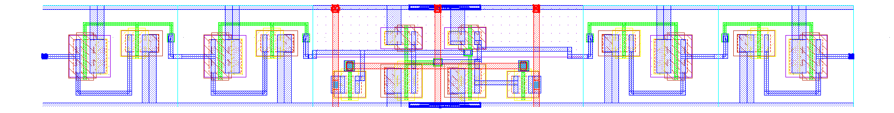
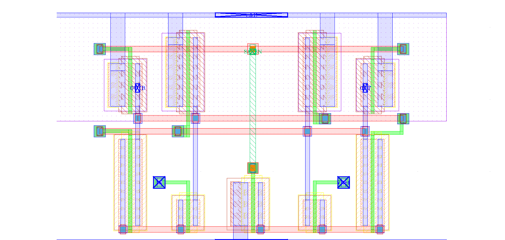
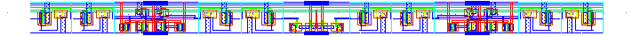
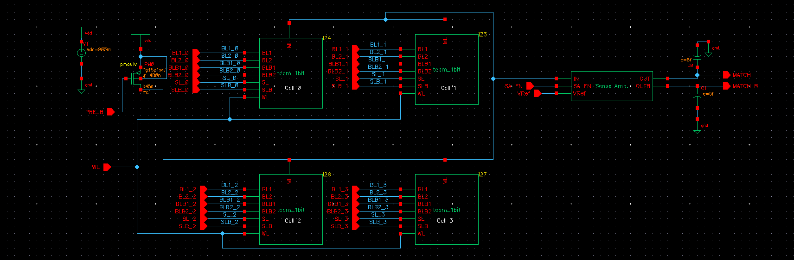
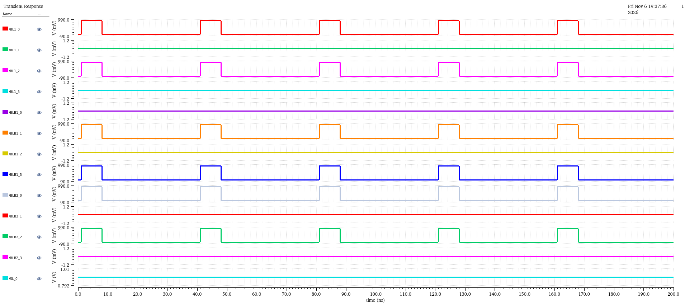
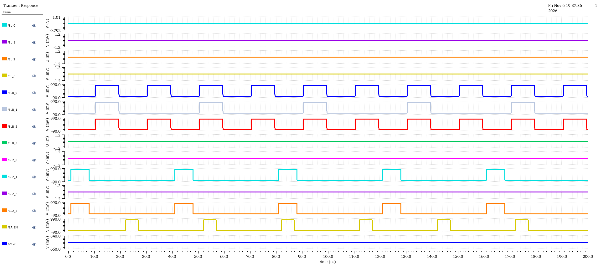
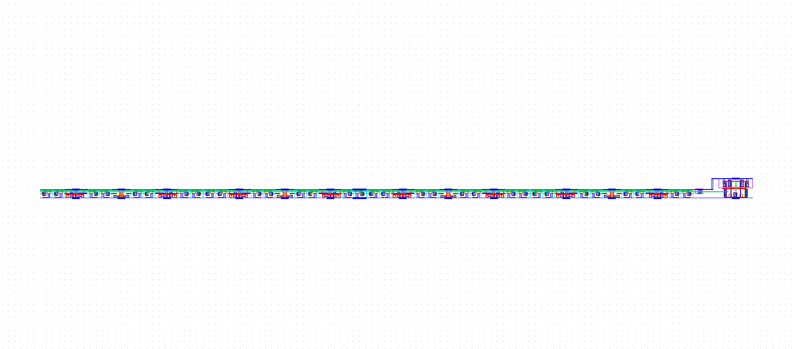

# Design and Full-Custom Implementation of a 4-Bit NOR-Type Ternary Content-Addressable Memory (TCAM) Word in Cadence Virtuoso (45 nm)

**Layout images:** [View the TCAM layout images on Google Drive](https://drive.google.com/file/d/10opFxxCp-OBFPHLrowXiV9xpsiarFPqi/view?usp=sharing)

## 1. Project Overview

This repository documents the transistor-level design of a **4-bit NOR-type Ternary Content-Addressable Memory (TCAM) word** in Cadence Virtuoso using the gpdk045 (45 nm) CMOS technology at a nominal supply voltage of **0.9 V**.

A TCAM stores three states per bit: `0`, `1` and `X` (don't care). It compares a stored word against a search word in parallel. In a NOR-type architecture, the cells share a precharged match line (`ML`). The match line remains high when all compared bits match; any mismatching bit activates a discharge path.

The implementation follows a hierarchical design flow, from a gate-level reference model to SRAM storage, transistor-level comparison, match-line sensing and physical layout views.

### 1.1 Scope and Status

| Item | Status |
|---|---|
| Gate-level reference model | Verified for exact match, masked mismatch and unmasked mismatch |
| 6T SRAM storage core | Write 0, write 1 and hold demonstrated |
| Nominal 16T TCAM cell | Schematic complete; standalone results limited to stored 1, searched 1 |
| 4-bit TCAM row | Schematic and integrated transient captures included; complete functional verification pending |
| Latch-type sense amplifier | One standalone input polarity demonstrated; reset and output-swing limitations identified |
| Physical layout views | Included for the NOR-2 gate, SRAM, sense amplifier, TCAM bit cell and 4-bit row |
| Layout DRC and LVS | Results not reported |
| Parasitic extraction and post-layout simulation | Not reported |
| Timing and power calculations | Preliminary; measurement validation required |
| Multi-word array, write decoder and priority encoder | Outside the transistor-level results reported here |

The reported transistor-level implementation is **one 4-bit word**, equivalent to a **1 × 4 TCAM row**, not a 4-word × 4-bit array.

The designation **16T** refers to the storage-and-comparison core. Additional SRAM output-buffer transistors are excluded from that count.

### 1.2 Design Hierarchy

- **Gate-level reference model:** per-bit XOR comparison, mask control and NOR-4 word combination.
- **6T SRAM storage core:** two cross-coupled CMOS inverters and two access transistors.
- **TCAM bit cell:** two SRAM storage cores and four NMOS comparison transistors.
- **4-bit TCAM row:** four bit cells sharing a match line, word line and precharge circuitry.
- **Match-line sense amplifier:** a differential regenerative circuit connected to the shared match line.

## 2. Technology and Design Tools

| Item | Detail |
|---|---|
| Technology | gpdk045, 45 nm CMOS |
| MOS devices | gpdk045 NMOS and PMOS devices |
| Nominal transistor length | 45 nm |
| Nominal supply voltage | VDD = 0.9 V |
| Schematic and layout environment | Cadence Virtuoso |
| Circuit simulation | Spectre transient analysis in ADE |
| Waveform analysis | Virtuoso Visualization and Analysis (ViVA) |
| Sense-amplifier output loads | 5 fF on each of `MATCH` and `MATCH_B` |

No explicit match-line capacitor is included in the reported schematic. The schematic-level match-line capacitance arises from connected device terminals. Extracted interconnect parasitics are not included.

## 3. Architecture

Four TCAM bit cells share one match line. A PMOS transistor with W = 480 nm and L = 45 nm precharges `ML` to VDD when `PRE_B` is low.

During evaluation, the precharge device turns off and the search inputs activate the comparison networks. A mismatch in any bit creates a conducting path from `ML` to ground. If no bit contributes a mismatch, the match line retains its precharged voltage for the evaluation interval.

The match line connects to the `IN` terminal of the sense amplifier. The amplifier compares this voltage with `VREF` and is intended to generate the digital match decision.


*Figure 1. Architecture of the single-word, 4-bit NOR-type TCAM.*

## 4. Flow of Implementation

1. Gate-level reference model using per-bit comparison, masking and NOR-4 combination.
2. SRAM storage-cell design and transient verification.
3. TCAM bit-cell construction using two SRAM cores and four compare transistors.
4. Standalone bit-cell simulation.
5. Four-cell row assembly with a shared match line.
6. Match-line sense-amplifier design and integration.
7. Physical layout views for the principal circuit blocks.
8. Preliminary timing, power and derived performance calculations.

## 5. Gate-Level Reference Model

The gate-level model defines the intended comparison and masking function independently of the memory-cell implementation.

Words are written MSB first: `D3 D2 D1 D0`, `M3 M2 M1 M0` and `S3 S2 S1 S0`.

### 5.1 Per-Bit Mask Control

For stored data `D`, search data `S` and mask `M`:

$$
X_i = D_i \oplus S_i
$$

$$
MM_i = X_i \cdot \overline{M_i}
$$

Here, `MM_i` is the per-bit mismatch signal.

- `M_i = 0`: the bit is compared.
- `M_i = 1`: the bit is masked and cannot contribute a mismatch.

| M | D ⊕ S | MM | Interpretation |
|---|---|---|---|
| 0 | 0 | 0 | Compared, equal |
| 0 | 1 | 1 | Compared, different |
| 1 | 0 | 0 | Masked |
| 1 | 1 | 0 | Masked |

### 5.2 NOR-4 Word Combiner

The four mismatch signals are combined as:

$$
MATCH = \overline{MM_0 + MM_1 + MM_2 + MM_3}
$$

`MATCH` is high only when every mismatch signal is low.

The reference implementation uses three OR gates followed by an inverter.


*Figure 2. NOR-4 word-combiner schematic.*

The NOR-4 simulation applies periodic inputs with periods of 20, 40, 80 and 160 ns. The output is high during the intervals in which all four inputs are low.


*Figure 3. Transient response of the NOR-4 combiner.*

### 5.3 NOR-2 Physical Layout

The CMOS NOR-2 gate uses two series PMOS transistors in the pull-up network and two parallel NMOS transistors in the pull-down network.



*Figure 4. Physical layout view of the NOR-2 gate.*

This layout is included as a basic logic building block. Three cascaded NOR-2 gates do not directly implement the required NOR-4 function.

If two NOR-2 gates produce:

$$
X_0 = \overline{MM_0 + MM_1}, \qquad
X_1 = \overline{MM_2 + MM_3},
$$

their outputs require an AND operation:

$$
MATCH = X_0 \cdot X_1
= \overline{MM_0 + MM_1 + MM_2 + MM_3}.
$$

### 5.4 Top-Level 4-Bit Gate-Level TCAM

Four mask-control units drive the NOR-4 combiner. The inputs are `D[3:0]`, `M[3:0]` and `S[3:0]`; the output is `MATCH`.


*Figure 5. Top-level 4-bit gate-level reference model.*

| Case | D | M | S | Expected MATCH | Reported MATCH |
|---|---|---|---|---|---|
| Exact match | 1010 | 0000 | 1010 | 1 | Approximately 0.9 V |
| Masked mismatch | 1010 | 0001 | 1011 | 1 | Approximately 0.9 V |
| Unmasked mismatch at bit 1 | 1010 | 0000 | 1000 | 0 | Approximately 43 nV |


*Figure 6. Gate-level exact-match result.*



*Figure 7. Gate-level masked-mismatch result.*


*Figure 8. Gate-level unmasked-mismatch result.*

These simulations use static input vectors. They verify the comparison function but do not demonstrate memory storage or characterize propagation delay.

## 6. 6T SRAM Cell

### 6.1 Circuit

The SRAM storage core consists of two cross-coupled CMOS inverters and two NMOS access transistors controlled by `WL`.

In the implemented schematic, each storage output is passed through a two-inverter buffer. The TCAM comparison network therefore loads buffered copies of the stored values rather than directly loading the internal latch nodes.

| Device | Function | W / L |
|---|---|---|
| PM1, PM2 | Pull-up PMOS | 180 nm / 45 nm |
| NM1, NM2 | Pull-down NMOS | 360 nm / 45 nm |
| A1, A2 | Access NMOS | 250 nm / 45 nm |
| Output buffers | Two inverter stages on each output | Inverter sub-cells |

The pull-down-to-access width ratio is 1.44. The pull-up-to-access width ratio is 0.72. These geometric ratios alone do not establish read stability or write margin.

The buffer transistors are additional to the six-transistor storage core.


*Figure 9. SRAM schematic with a 6T storage core and buffered outputs.*

### 6.2 Operation

- **Hold:** `WL = 0` isolates the storage nodes from the bit lines. The cross-coupled inverters retain the state while power is supplied.
- **Write:** complementary values on `BL` and `BLB`, together with an asserted `WL`, update the storage state.
- **Read:** conventional differential bit-line reading is not exercised in the reported TCAM simulations. The comparison network uses the buffered storage outputs.

### 6.3 Simulation Conditions

The reported standalone SRAM simulation uses a 0.9 V logic-high level and a stop time of 250 ns.

The word-line stimulus has a nominal delay of 10 ns, pulse width of 10 ns and period of 20 ns. Complementary bit-line stimuli use a nominal delay of 5 ns, pulse width of 20 ns and period of 40 ns. The specified rise and fall times are 0.1 ns.

### 6.4 Results

The transient results demonstrate write 0, write 1 and hold operations. During a selected write interval, the cell updates according to the driven bit lines. After `WL` returns low, the stored value is retained even when the bit-line inputs change.

The reported outputs remain complementary and switch between approximately 0 V and 0.9 V. Read stability, static noise margin and write margin have not been characterized.


*Figure 10. SRAM transient response showing write and hold operations.*

### 6.5 Layout



*Figure 11. Physical layout view of the SRAM storage cell.*

The layout image is included for documentation. DRC and LVS results are not reported.

## 7. Latch-Type Match-Line Sense Amplifier

### 7.1 Topology

The sense amplifier compares `IN`, connected to the match line, with a reference voltage. A cross-coupled latch provides regeneration.

| Device | Function | W / L |
|---|---|---|
| N1, M_IN1 | Input transistor, gate `IN` | 360 nm / 45 nm |
| N3, M_IN2 | Reference transistor, gate `VREF` | 360 nm / 45 nm |
| N2 | Input-pair tail switch, gate `SA_EN` | 600 nm / 45 nm |
| N4, N5, M_N1, M_N2 | Cross-coupled NMOS latch; sources connected to ground | 1.2 µm / 45 nm |
| P1, P2, M_P1, M_P2 | Cross-coupled PMOS latch | 960 nm / 45 nm |
| P3, P4 | Output-reset PMOS devices, gates `SA_EN` | 600 nm / 45 nm |


*Figure 12. Sense-amplifier architecture reference.*


*Figure 13. Transistor-level schematic of the implemented sense amplifier.*

### 7.2 Pin Definition

| Pin | Direction | Function |
|---|---|---|
| IN | Input | Match-line voltage |
| VREF | Input | Reference voltage |
| SA_EN | Input | Sense-enable control |
| OUT, MATCH | Output | Intended positive match decision |
| OUTB, MATCH_B | Output | Intended complementary decision |

### 7.3 Intended Operation

1. **Reset, `SA_EN = 0`:** the reset PMOS devices pull both outputs toward VDD while the input-pair tail switch is off.
2. **Evaluation, `SA_EN = 1`:** the input pair develops a differential response according to `IN` relative to `VREF`. Positive feedback is intended to resolve the outputs to opposite logic states.

The cross-coupled NMOS latch remains connected to ground in the implemented circuit. Consequently, disabling the input-pair tail switch does not disable the entire latch.

### 7.4 Standalone Simulation Results

The reported standalone simulation uses `IN ≈ 0.85 V`, `VREF = 0.75 V` and VDD = 0.9 V. The sense-enable pulse has a nominal delay of 10 ns, width of 20 ns and period of 40 ns. The simulation runs to 100 ns.

| Phase | OUT | OUTB |
|---|---|---|
| Before the first enable | Approximately 0.66 V | Approximately 0.68 V |
| SA_EN high | Approximately 0.82 V | Approximately 0.02 V |
| SA_EN low after evaluation | Approximately 0.83 V | Approximately 0.10 V |


*Figure 14. Standalone sense-amplifier response with IN above VREF.*

### 7.5 Layout



*Figure 15. Physical layout view of the match-line sense amplifier.*

### 7.6 Observations and Limitations

- **One standalone polarity demonstrated:** the reported `IN > VREF` case produces a high `OUT` and low `OUTB` during evaluation.
- **Output swing:** the recorded levels do not reach both supply rails.
- **Incomplete reset:** the outputs do not both return to VDD after evaluation. The always-active latch pull-down paths can oppose the reset devices and contribute to contention.
- **Additional verification required:** reverse input polarity, changing input polarity between cycles, minimum resolvable voltage difference and decision time have not been established.
- **Integrated outputs included:** Section 9.3 contains row-level `MATCH` and `MATCH_B` traces, but these do not establish complete integrated functionality.

A clock-controlled footer for the latch pull-down network is a possible reset revision. Its topology, sizing and timing require simulation. Output buffering may isolate the load but does not independently correct sensing or reset errors.

## 8. Nominal 16T NOR-Type Ternary Cell

### 8.1 Topology

Each TCAM bit cell contains:

- Two SRAM storage cores representing `Q1` and `Q2`.
- A shared word line, `WL`.
- Separate write pairs, `BL1`/`BLB1` and `BL2`/`BLB2`.
- Two parallel mismatch-discharge branches, each containing two series NMOS transistors.

The compare devices have W = 240 nm and L = 45 nm.

- **Stack A:** a transistor controlled by `SL` in series with a transistor controlled by `Q1`.
- **Stack B:** a transistor controlled by `SLB` in series with a transistor controlled by `Q2`.

The core count is:

$$
N_{\text{core}} = 2 \times 6 + 4 = 16
$$

This count excludes the output-buffer transistors inside the SRAM sub-cells and excludes row-level precharge and sensing circuitry. The SRAM `QB` outputs are not used by the compare branches.


*Figure 16. TCAM bit-cell schematic with two SRAM blocks and two compare stacks.*

### 8.2 Ternary Storage Encoding

For data `D` and mask `M`, where `M = 1` indicates don't care:

$$
Q_1 = \overline{D}\cdot\overline{M}, \qquad
Q_2 = D\cdot\overline{M}
$$

| Stored value | Q1 | Q2 | BL1 / BLB1 / BL2 / BLB2 during writing |
|---|---|---|---|
| 0 | 1 | 0 | 0.9 / 0 / 0 / 0.9 V |
| 1 | 0 | 1 | 0 / 0.9 / 0.9 / 0 V |
| X | 0 | 0 | 0 / 0.9 / 0 / 0.9 V |
| Invalid | 1 | 1 | Not used |

Search-line encoding is:

| Search key | SL | SLB |
|---|---|---|
| 0 | 0 V | 0.9 V |
| 1 | 0.9 V | 0 V |
| X, query-masked bit | 0 V | 0 V |

The combination `SL = SLB = 0.9 V` is not a valid binary-search or query-mask encoding.

### 8.3 Compare Operation

A discharge branch conducts only when both series transistors are on.

The per-bit mismatch function is:

$$
MM = SL\cdot Q_1 + SLB\cdot Q_2
$$

For complementary binary search inputs, this reproduces the masked comparison function.

| Stored value | Search 0 | Search 1 | Search X |
|---|---|---|---|
| 0 | Match | Mismatch through Stack A | Match |
| 1 | Mismatch through Stack B | Match | Match |
| X | Match | Match | Match |

These entries describe the intended per-bit behavior. A bit marked as matching does not prevent another bit in the same row from discharging the shared match line.

### 8.4 Standalone Bit-Cell Simulation

The included standalone case uses stored `D = 1` and search `S = 1`. The corresponding storage state is `Q1 = 0`, `Q2 = 1`, and the search encoding is `SL = 0.9 V`, `SLB = 0 V`.

For a correctly precharged match line, neither branch should conduct during this search.


*Figure 17. Standalone TCAM bit-cell waveform for the reported stored-1/search-1 case.*

The available standalone results are limited to this case. Stored 0, stored X and the remaining stored/search combinations require verification.

A valid evaluation requires the stored state to be established before comparison, `WL` to remain low during search, and the match line to be precharged without an active discharge path.

### 8.5 Layout



*Figure 18. Physical layout view of the TCAM bit cell.*

## 9. 4-Bit TCAM Row

### 9.1 Implementation

Four bit cells share `ML` and `WL`. Each cell has its own write bit lines and search-line pair.

A common PMOS device precharges the match line. The sense-amplifier input connects to `ML`, and its outputs are labelled `MATCH` and `MATCH_B`.



*Figure 19. Schematic of the 4-bit TCAM row and sense amplifier.*

The asset filename `tcam_row_4x4.png` is retained, but the documented circuit is a single 4-bit row.

### 9.2 Simulation Conditions

The row captures span approximately 0–200 ns and include write bit lines, search lines, `WL`, `PRE_B`, `SA_EN`, `VRef` and the integrated output signals.

The intended write pattern is:

$$
D = 1010, \qquad M = 0000
$$

Cells 0 and 2 are intended to store 0; cells 1 and 3 are intended to store 1. Write and search encodings are defined in Section 8.2.

The plots contain different repetition rates for the write, search and sensing signals. A single common 60 ns period is therefore not assumed. Exact pulse parameters must be taken from the corresponding ADE setup before quantitative timing extraction.

### 9.3 Waveform Results

All three figures below show different signal groups from the **same transient simulation**. They are not separate exact-match, mismatch and complete-operation tests.

#### Write-Line Signals

The first capture shows `BL1_i`, `BLB1_i`, `BLB2_i` and `SL_0`. The remaining `BL2_i` signals appear in the next capture.

The write-line pattern applies the intended data encoding. Successful storage must be confirmed from the internal storage nodes or their buffered outputs after the write interval.



*Figure 20. Write-line signals and SL_0 from the row simulation.*

#### Search, Write and Sensing Signals

The second capture shows the search inputs, `BL2_0`–`BL2_3`, `SA_EN` and `VRef`.

The signals labelled `BL2_i` are write bit lines, not match-line nodes.



*Figure 21. Search inputs, BL2 write lines, sense enable and reference voltage.*

#### Control and Output Signals

The third capture includes `WL`, `PRE_B`, `SA_EN`, `MATCH` and `MATCH_B`, together with additional search and write signals.


*Figure 22. Integrated row control and output waveforms.*

The captures have the following verification limitations:

- A separate shared-`ML` trace is not shown in these three figures.
- The stimulus includes intervals with both `SL_0` and `SLB_0` high. This is not a valid binary-search or query-mask encoding.
- Output decisions must be checked within the corresponding sensing windows against the applied search encoding.
- `MATCH` and `MATCH_B` must not be assumed to be complementary throughout reset and evaluation.
- The available captures do not independently establish verified exact-match and single-bit-mismatch cases.

The row requires repeated simulation with valid search-line pairs, confirmed stored states, explicit match-line observation and corrected sense-amplifier reset behavior.

### 9.4 Layout



*Figure 23. Physical layout view of the 4-bit TCAM row.*

Layout images are also available through the Google Drive link at the beginning of this document. Physical verification and extracted simulation results are not reported.

## 10. Preliminary Performance Calculations

The following calculations use previously reported timing and power values. They are preliminary arithmetic estimates, not validated circuit-performance results.

### 10.1 Reported Values and Assumptions

| Parameter | Reported value | Status |
|---|---:|---|
| Low-to-high delay extraction | −5.044 ns | Trigger, output edge and cycle selection require verification |
| High-to-low delay extraction | 4.943 ns | Measurement definition requires verification |
| Average power | 315.9 pW | Supply-current measurement and averaging interval require verification |

For the calculations below only, a positive value of **5.044 ns** is provisionally assumed for the low-to-high delay.

A negative delay cannot be corrected solely by taking its absolute value. The corresponding input and output crossings must first be checked.

### 10.2 Average Delay Estimate

Assuming both delays are valid and consistently defined:

$$
t_p = \frac{t_{PLH} + t_{PHL}}{2}
$$

$$
t_p = \frac{5.044 + 4.943}{2}
= 4.9935\ \text{ns}
\approx 4.994\ \text{ns}
$$

### 10.3 Power–Delay Product

$$
PDP = P_{avg}\times t_p
$$

Using the unrounded delay:

$$
PDP = (315.9\times10^{-12})(4.9935\times10^{-9})
$$

$$
PDP \approx 1.577\times10^{-18}\ \text{J}
= 1.577\ \text{aJ}
$$

### 10.4 Delay-Based Energy–Delay Estimate

Using the power–delay product as an energy estimate:

$$
EDP_{\text{estimate}} = PDP\times t_p
= P_{avg}\times t_p^2
$$

$$
EDP_{\text{estimate}}
= (315.9\times10^{-12})(4.9935\times10^{-9})^2
$$

$$
EDP_{\text{estimate}}
\approx 7.877\times10^{-27}\ \text{J}\cdot\text{s}
= 7.877\ \text{fJ}\cdot\text{ps}
$$

### 10.5 Calculation Summary

| Quantity | Provisional value | Unit |
|---|---:|---|
| Assumed low-to-high delay | 5.044 | ns |
| Reported high-to-low delay | 4.943 | ns |
| Average delay estimate | 4.994 | ns |
| Reported average power | 315.9 | pW |
| Power–delay product | 1.577 | aJ |
| Delay-based energy–delay estimate | 7.877 | fJ·ps |

### 10.6 Measurement Requirements

**Timing:** corresponding trigger and output crossings should be measured using a defined threshold, such as 50% of VDD, or 0.45 V.

For the dynamic sense amplifier, evaluation-to-decision delay and reset recovery are different measurements. A `MATCH` rising transition during reset must not automatically be treated as a low-to-high match-decision delay.

**Power:** average power must be obtained from the actual supply voltage and supply current over a stated steady-state interval:

$$
P_{avg}
= \frac{1}{T}\int_{t_0}^{t_0+T}P_{\text{supply}}(t)\,dt
$$

If supply-source current is defined as positive into the positive terminal of the ideal voltage source:

$$
P_{\text{supply}}(t)
= -V_{DD}(t)\,I_{VDD}(t)
$$

The sign convention, measurement boundary, units and averaging interval require confirmation. The reported 315.9 pW value is exceptionally small for the switching circuit and must be checked against the supply-current waveform.

**Search energy:** the power–delay product is not automatically the energy consumed during one complete search:

$$
E_{\text{search}}
= \int_{t_0}^{t_0+T_{\text{search}}}
P_{\text{supply}}(t)\,dt
$$

The corresponding search energy–delay product is:

$$
EDP_{\text{search}}
= E_{\text{search}}\times t_{\text{decision}}
$$

These quantities remain to be validated.

## 11. Summary of Verification

| Block | Evidence included | Remaining verification |
|---|---|---|
| Gate-level reference | Exact match, masked mismatch and unmasked mismatch | Exhaustive functional vectors and timing |
| SRAM storage core | Write 0, write 1 and hold | Read stability, noise margins, write margin and corners |
| TCAM bit cell | Reported stored-1/search-1 capture | Remaining stored/search combinations and stored X |
| 4-bit row | Write, search, control and integrated output captures from one run | Valid exact match, mismatch at each bit, stored X and query masking |
| Sense amplifier | Standalone IN above VREF | Reverse polarity, reset, output swing, sensitivity and decision time |
| Physical layouts | Layout images | DRC, LVS, extraction and post-layout simulation |
| Performance | Preliminary calculations | Validated timing, supply power and energy measurements |

A systematic comparison between the transistor-level row and the gate-level reference model has not been completed. Process–voltage–temperature characterization and post-layout performance are not reported.

## 12. Conclusion

A single 4-bit NOR-type TCAM word was designed in Cadence Virtuoso using the gpdk045 (45 nm) CMOS technology at a nominal supply voltage of 0.9 V. The implementation combines SRAM-based storage, NMOS comparison networks, a shared precharged match line and a latch-type sense amplifier. Each bit uses a nominal 16-transistor storage-and-comparison core, excluding additional SRAM output buffers.

The gate-level reference model demonstrates exact match, masked mismatch and unmasked mismatch. SRAM transient results demonstrate write 0, write 1 and hold operations. Standalone TCAM-cell results are limited to the stored-1/search-1 condition. The row-level captures document one transient stimulus sequence and require further verification using valid search encodings and explicit match-line observation.

The sense amplifier demonstrates a decision for one standalone input polarity but has incomplete reset and limited output swing. These limitations must be addressed before complete integrated functionality can be established.

Physical layout views are included for the NOR-2 gate, SRAM cell, sense amplifier, TCAM bit cell and 4-bit row. Layout screenshots do not establish DRC or LVS compliance; verification reports, parasitic extraction and post-layout simulation are not included.

Preliminary timing, average-power, power–delay and delay-based energy–delay calculations are presented. Their measurement definitions and extraction require validation before they can be reported as characterized performance. Remaining work includes complete ternary-state verification, sense-amplifier refinement, physical verification, extracted simulation and process–voltage–temperature analysis. Multi-word array implementation remains outside the reported transistor-level scope.

## 13. Repository Structure

```text
4-Word-4-Bit-NOR-Based-TCAM/
│
├── README.md
│
└── images/
    ├── architecture.png
    │
    ├── gate_level_model/
    │   ├── nor_4bit_schematic.png
    │   ├── nor-4_waveform.bmp
    │   ├── nor2_layout.png
    │   ├── tcam_4bit_reference_model.png
    │   ├── tcam_exact_match.bmp
    │   ├── tcam_dont-care.bmp
    │   └── tcam_mismatch.bmp
    │
    ├── 6t_sram/
    │   ├── sram_6t_schematic.png
    │   └── sram_6t_waveform.bmp
    │
    ├── sense_amplifier/
    │   ├── sense_amp_architecture.png
    │   ├── sense_amp_schematic.png
    │   └── sense_amp_waveform1.bmp
    │
    ├── tcam_1bit/
    │   ├── tcam_1bit_schematic.png
    │   └── tcam_1bit_waveform.bmp
    │
    ├── tcam_4x4/
    │   ├── tcam_row_4x4.png
    │   ├── tcam_row_waveform1.bmp
    │   ├── tcam_row_waveform2.bmp
    │   └── tcam_row_waveform3.bmp
    │
    └── layout/
        ├── 6t_sram_layout.png
        ├── sense_amp_layout.png
        ├── tcam_1bit_layout.png
        └── tcam_4bit_layout.png
```

---

<div align="center">

### Author

**Pranjal Upadhyay**  
Roll No.: 523EC0012  
Department of Electronics and Communication Engineering  
Integrated Bachelor and Master of Technology  
**Indian Institute of Information Technology Design and Manufacturing, Kurnool**

---

© 2025 Pranjal Upadhyay — All Rights Reserved

</div>
