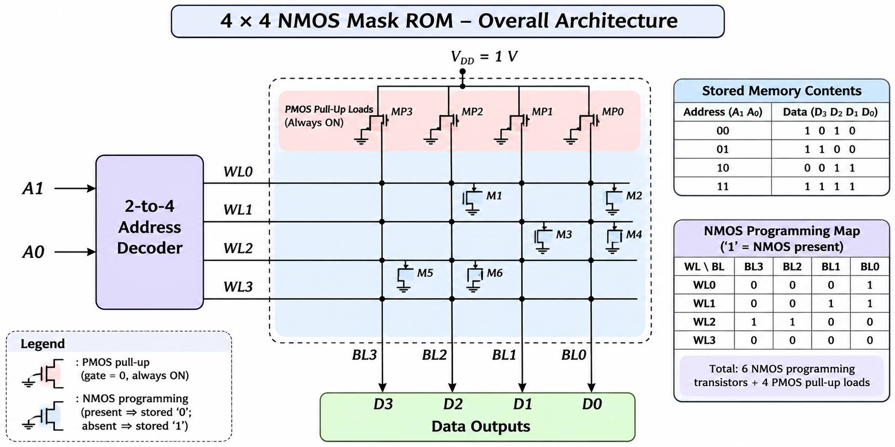

# Design and Full-Custom Implementation of a 4-Bit NOR-Type Ternary CAM (TCAM) Using Cadence Virtuoso (45 nm CMOS Technology)

## 1. Project Overview

This repository documents the full-custom, transistor-level design of a **4-bit NOR-type Ternary Content-Addressable Memory (TCAM)** in Cadence Virtuoso using the gpdk045 (45 nm) CMOS technology.

A TCAM stores three possible states per bit (`0`, `1`, and `X` / don't care) and performs parallel comparisons between a stored word and an input search word, producing a single `MATCH` output.

The design is developed hierarchically, progressing from a gate-level reference model to transistor-level memory, comparison, and sensing circuits.

### Design Hierarchy

- **Gate-Level Reference Model:** Functional verification using ideal CMOS logic gates (XOR, AND, OR, NOR-4).
- **6T SRAM Storage Cell:** A static 6-transistor memory cell used twice per TCAM bit for dual-rail storage (`Q1`, `Q2`).
- **16T NOR-Type TCAM Cell:** Integration of two 6T SRAM cells with a four-NMOS dynamic comparison network.
- **4-Bit TCAM Row:** Four TCAM cells connected in parallel, sharing a dynamically precharged match line (`ML`) with a 5 fF load.
- **Latch-Type Sense Amplifier:** A differential cross-coupled amplifier designed for match-line sensing.

### Repository Structure

4-Bit-TCAM/
│
├── README.md
│
└── images/
    │
    ├── architecture.png
    ├── sense_amp_architecture.png
    │
    ├── 1_Gate_Level_Model/
    │   ├── nor_4bit_schematic.png
    │   ├── nor-4_waveform.bmp
    │   ├── tcam_4bit_reference_model.png
    │   ├── tcam_exact_match.bmp
    │   ├── tcam_dont-care.bmp
    │   └── tcam_mismatch.bmp
    │
    ├── 2_6T_SRAM/
    │   ├── sram_6t_schematic.png
    │   └── sram_6t_waveform.bmp
    │
    ├── 3_Sense_Amplifier/
    │   ├── sense_amp_schematic.png
    │   └── sense_amp_waveform1.bmp
    │
    ├── 4_TCAM_1Bit/
    │   ├── tcam_1bit_schematic.png
    │   └── tcam_1bit_waveform.bmp
    │
    └── 5_TCAM_4Bit_Row/
        ├── tcam_row_4x4.png
        ├── tcam_row_waveform1.bmp
        ├── tcam_row_waveform2.bmp
        └── tcam_row_waveform3.bmp

## 2. Technology and Design Tools

| Item              | Detail                                      |
|-------------------|---------------------------------------------|
| Technology        | gpdk045 (45 nm CMOS)                        |
| Devices           | g45n1svt (NMOS), g45p1svt (PMOS), L = 45 nm |
| Design entry      | Cadence Virtuoso Schematic Editor           |
| Simulation        | Spectre transient analysis (ADE)            |
| Waveform viewer   | Virtuoso Visualization & Analysis (ViVA)    |
| Supply            | VDD = 0.9 V                                 |
| Match-line load   | CML = 5 fF                                  |

## 3. Architecture

The 4-bit TCAM word consists of four 16T TCAM cells sharing a single precharged match line (ML). A PMOS precharge transistor restores ML to VDD prior to each search evaluation. An explicit capacitor ($C_{ML} = 5\text{ fF}$) models the total parasitic capacitance of the line. The match line connects directly to a latch-type sense amplifier, which senses the ML discharge and outputs a full-swing digital MATCH signal.

*Figure 1. Architecture of the 4-bit NOR-type TCAM word.*

## 4. Flow of Implementation

1. Gate-level functional reference (XOR-AND mask control + NOR-4).  
2. 6T SRAM cell design and verification.  
3. 16T TCAM bit cell (two 6T SRAMs + four compare NMOS).  
4. 1-bit TCAM cell characterization.  
5. 4-bit TCAM row with shared match line.  
6. Latch-type match-line sense amplifier.  
7. Integration and final verification.

## 5. Gate-Level Reference Model

The gate-level reference model establishes the golden functional baseline for the TCAM array. It models the per-bit comparison, don't-care masking, and multi-bit match aggregation using ideal logic gates to verify system functionality prior to full-custom transistor-level design.

### 5.1 Per-Bit Mask Control

Each bit position evaluates the stored data bit ($D_i$), search bit ($S_i$), and mask bit ($M_i$). The per-bit comparison generates an intermediate mismatch signal ($MM_i$):

$$X_i = D_i \oplus S_i, \qquad MM_i = X_i \cdot \overline{M_i}$$

- **$M_i = 0$ (Search Mode):** The bit is actively compared. If $D_i \neq S_i$, $MM_i = 1$ (mismatch).
- **$M_i = 1$ (Masked Mode):** The bit is ignored (don't care state X), forcing $MM_i = 0$ regardless of $D_i$ and $S_i$.

| $M_i$ | $D_i \oplus S_i$ | $MM_i$ (Mismatch) | Functional State |
|---|---|---|---|
| 0 | 0 | 0 | Compared, bits equal (Match) |
| 0 | 1 | 1 | Compared, bits differ (Mismatch) |
| 1 | 0 | 0 | Masked (Don't Care) |
| 1 | 1 | 0 | Masked (Don't Care) |

### 5.2 NOR-4 Word Combiner

In a NOR-type TCAM architecture, a single mismatching bit in a word must drive the overall word output to logic low. To implement this functional behavior at the gate level, a 4-input NOR structure aggregates the individual per-bit mismatch signals ($MM_0$ to $MM_3$):

$$MATCH = \overline{MM_0 + MM_1 + MM_2 + MM_3}$$

The output $MATCH$ remains logic high ($1$) only when all unmasked bits match ($MM_i = 0$ for all $i$). Any active mismatch ($MM_i = 1$) pulls $MATCH$ to logic low ($0$).

  
*Figure 5.1. NOR-4 word combiner schematic.*

  
*Figure 5.2. Transient simulation waveform of the NOR-4 combiner block.*

### 5.3 Top-Level 4-Bit Gate-Level TCAM

The top-level reference model integrates four per-bit mask-control units driving the single NOR-4 combiner block. It operates on 12 input signals ($D[3:0]$, $M[3:0]$, $S[3:0]$) and outputs a scalar $MATCH$ decision signal.

  
*Figure 5.3. Top-level 4-bit gate-level TCAM schematic combining four mask-control modules with the NOR-4 combiner.*

#### Functional Verification Waveforms

The behavior of the top-level gate-level model was validated under three operating conditions:

1. **Exact Match Condition ($D = 1010, M = 0000, S = 1010$):** All unmasked bits match, maintaining $MATCH = 1$.
2. **Masked Match / Don't-Care Condition ($D = 1010, M = 0001, S = 1011$):** Bit 0 differs ($D_0=0, S_0=1$), but $M_0=1$ masks the mismatch, maintaining $MATCH = 1$.
3. **Mismatch Condition ($D = 1010, M = 0000, S = 1000$):** Bit 1 differs ($D_1=1, S_1=0$) while unmasked ($M_1=0$), forcing $MATCH = 0$.

  
*Figure 5.4. Transient response for exact match condition.*

  
*Figure 5.5. Transient response for masked don't-care condition.*

  
*Figure 5.6. Transient response for mismatch condition.*

## 6. 6T SRAM Cell and Storage Encoding

### 6.1 Ternary Encoding Scheme

While a Binary Content-Addressable Memory (BCAM) bit requires a single 6T SRAM cell to store logic states `0` and `1`, a Ternary CAM (TCAM) bit must store a third "don't care" state (`X`). To support three valid logical states, each 16T TCAM cell integrates two independent 6T SRAM cells, storing values at internal nodes $Q_1$ and $Q_2$.

The storage mapping for data ($D$) and mask ($M$, where $M = 1$ indicates don't care) is defined as follows:

$$Q_1 = \overline{D} \cdot \overline{M}, \qquad Q_2 = D \cdot \overline{M}$$

| Stored Value | Q1 | Q2 | Description |
|---|---|---|---|
| **0** | 1 | 0 | Logic 0 stored; compare active |
| **1** | 0 | 1 | Logic 1 stored; compare active |
| **X** | 0 | 0 | Don't care state; bit comparison masked |
| **Invalid** | 1 | 1 | Unused / illegal state |

### 6.2 6T SRAM Circuit Operation

Each instantiated 6T SRAM cell serves as the static memory storage element. The cell consists of:

- **Storage Latch (4 Transistors):** Two cross-coupled CMOS inverters ($M_1$–$M_4$) form a bistable latch that holds complementary logic levels at internal nodes $Q$ and $\bar{Q}$.
- **Access Devices (2 Transistors):** Two NMOS pass-transistors ($M_5$, $M_6$) controlled by the word line ($WL$) connect nodes $Q$ and $\bar{Q}$ to the complementary bit lines ($BL$ and $BLB$).

#### Operational Modes:
- **Hold Mode ($WL = 0$):** Access transistors remain OFF, isolating the internal latch nodes from $BL$ and $BLB$. The cross-coupled inverters maintain the stored voltage level continuously as long as supply power is maintained.
- **Write Mode ($WL = 1$):** Bit lines $BL$ and $BLB$ are driven to the target logic level and its inverse, respectively. Asserting $WL$ turns ON the access transistors, allowing the external drivers to overpower the cross-coupled inverters and update the latch state.
- **Read Mode ($WL = 1$):** Bit lines $BL$ and $BLB$ are precharged high. Driving $WL$ high connects the bit lines to the internal nodes. The node holding logic 0 pulls down its corresponding bit line slightly, producing a small differential voltage across $BL$ and $BLB$.

  
*Figure 6.1. 6T SRAM cell schematic topology.*

  
*Figure 6.2. Transient simulation waveform of the 6T SRAM cell.*

## 7. Match-Line Sense Amplifier

### 7.1 Topology and Pin Definition

A latch-type differential sense amplifier resolves small voltage variations on the match line ($ML$) relative to a static reference voltage ($V_{REF}$), restoring the decision to full CMOS rail-to-rail digital logic levels (`MATCH` and `MATCH_B`).

| Pin / Terminal | Signal Type | Function |
|---|---|---|
| **BL / IN** | Input | Connected to the Match Line ($ML$) |
| **BLB / VREF** | Input | Connected to the static reference voltage ($V_{REF} = 0.55\text{ V}$) |
| **SA_EN** | Input | Sense amplifier clock / enable signal |
| **SA_OUT / MATCH** | Output | Regenerated positive match output signal |
| **SA_OUTB / MATCH_B** | Output | Complementary match output signal |

### 7.2 Operation Principles

The cross-coupled latch structure operates in two distinct execution phases:

1. **Precharge / Reset Phase ($SA\_EN = 0$):**  
   The PMOS pull-up header devices driven by $SA\_EN$ turn ON, charging the internal evaluation nodes directly to $V_{DD}$. The differential sense path is disabled, resetting both outputs (`SA_OUT` and `SA_OUTB`) to logic high.

2. **Evaluation / Sensing Phase ($SA\_EN = 1$):**  
   The precharge PMOS devices turn OFF, enabling positive feedback within the cross-coupled inverter pair. Small potential differences between the input terminals ($BL$ and $BLB$) dictate the discharge rates of the internal storage nodes. The regenerative cross-coupled latch rapidly pulls the lower-potential side to $GND$ while driving the opposite side to $V_{DD}$, producing a stable full-swing digital output.

  
*Figure 7.1. Structural topology of the latch-type sense amplifier.*

  
*Figure 7.2. Cadence Virtuoso transistor-level schematic of the sense amplifier.*

  
*Figure 7.3. Transient response waveform showing differential sensing and signal regeneration.*

## 9. 1-Bit TCAM Cell

### 9.1 10T TCAM Bit-Cell Topology

Each 1-bit TCAM cell is designed using a **6T SRAM cell** for data storage and **4 NMOS transistors** for search comparison. Therefore, the complete bit cell becomes a **10T TCAM cell**.

The stored data is taken from the SRAM nodes **Q** and **Q̄**, while the search data is applied through **SL** and **SL̄**. A PMOS transistor is used to precharge the **Match Line (ML)** before every search operation.

The comparison network works as follows:

- If the stored bit and searched bit are the same, both discharge paths remain OFF and **ML stays HIGH → MATCH**.
- If the stored bit and searched bit are different, one of the NMOS stacks turns ON and **ML discharges to LOW → MISMATCH**.

| Stored Data (D) | Search Data (S) | Match Line (ML) | Result |
|:---:|:---:|:---:|:---:|
| 0 | 0 | HIGH | MATCH ✅ |
| 1 | 1 | HIGH | MATCH ✅ |
| 0 | 1 | LOW | MISMATCH ❌ |
| 1 | 0 | LOW | MISMATCH ❌ |

*Figure 5. Schematic of the 1-bit 10T TCAM cell.*

### 9.2 Simulation and Testing of 1-Bit TCAM

The 1-bit TCAM cell was simulated using transient analysis in Cadence Virtuoso with **VDD = 1.8 V**.

The operation was carried out in two phases:

1. **Write Phase** – Data was stored into the 6T SRAM portion using **WL, BL and BL̄**.
2. **Search Phase** – Search data was applied through **SL and SL̄**, and the Match Line was observed.

### 9.3 Input Test Conditions for 1-Bit TCAM

| Signal | V1 (V) | V2 (V) | TD (ns) | TR (ns) | TF (ns) | PW (ns) | PER (ns) |
|---|---:|---:|---:|---:|---:|---:|---:|
| PRE_B | 1.8 | 0 | 2 | 0.1 | 0.1 | 8 | 50 |
| WL | 0 | 1.8 | 12 | 0.1 | 0.1 | 10 | 50 |
| BL | 0 | 1.8 | 12 | 0.1 | 0.1 | 10 | 50 |
| BL̄ | 1.8 | 0 | 12 | 0.1 | 0.1 | 10 | 50 |
| SL | 0 | 1.8 | 28 | 0.1 | 0.1 | 16 | 50 |
| SL̄ | 1.8 | 0 | 28 | 0.1 | 0.1 | 16 | 50 |

For the tested case:

- **Stored Data, D = 1**
- **Search Data, S = 1**

Since both values were equal, the Match Line remained HIGH.

✅ **Result = MATCH**

*Figure 6. Transient simulation waveform of the 1-bit 10T TCAM cell.*

## 10. 4-Bit TCAM Row

### 10.1 4-Bit TCAM Row Implementation

Four 1-bit 10T TCAM cells were connected side by side to form a **4-bit TCAM row**. All four cells share a common **Match Line (ML)**, common **WL**, and common **PRE_B** signal.

However, the write and search lines were provided separately to each bit cell:

- **BL0–BL3** and **BL̄0–BL̄3** were used for writing data into each cell
- **SL0–SL3** and **SL̄0–SL̄3** were used for searching data into each cell

Since the Match Line of all four bits is shared, the row produces a MATCH output only when **all four stored bits match the searched bits**. If even one bit mismatches, the Match Line discharges and the output becomes MISMATCH.

*Figure 7. Schematic of the 4-bit TCAM row using four 10T TCAM cells.*

### 10.2 Simulation and Testing of 4-Bit TCAM Row

The 4-bit TCAM row was tested using transient simulation with **VDD = 1.8 V**.

### 10.3 Input Test Conditions for 4-Bit TCAM Row

| Signal | V1 (V) | V2 (V) | TD (ns) | TR (ns) | TF (ns) | PW (ns) | PER (ns) |
|---|---:|---:|---:|---:|---:|---:|---:|
| PRE_B | 1.8 | 0 | 2 | 0.1 | 0.1 | 8 | 60 |
| WL | 0 | 1.8 | 12 | 0.1 | 0.1 | 10 | 60 |

### 10.4 Test Case 1 — Exact Match

For the exact match condition, the stored data and search data were kept the same.

- **Stored Data, D = 1 0 1 0**
- **Search Data, S = 1 0 1 0**

| Bit | D | BL | BL̄ | S | SL | SL̄ |
|:---:|:---:|:---:|:---:|:---:|:---:|:---:|
| Bit 3 | 1 | 1.8 V | 0 V | 1 | 1.8 V | 0 V |
| Bit 2 | 0 | 0 V | 1.8 V | 0 | 0 V | 1.8 V |
| Bit 1 | 1 | 1.8 V | 0 V | 1 | 1.8 V | 0 V |
| Bit 0 | 0 | 0 V | 1.8 V | 0 | 0 V | 1.8 V |

Since all four bits matched, the shared Match Line remained HIGH.

✅ **Result = MATCH**

*Figure 8. Transient simulation waveform of the 4-bit TCAM row for match condition.*

### 10.5 Test Case 2 — Mismatch Condition

For the mismatch condition, one bit of the search data was changed.

- **Stored Data, D = 1 0 1 0**
- **Search Data, S = 1 0 0 0**

Because Bit 1 did not match, the Match Line discharged during the evaluate phase.

❌ **Result = MISMATCH**

*Figure 9. Transient simulation waveform of the 4-bit TCAM row for mismatch condition.*

### 10.6 Complete Search Operation

The complete simulation shows the write operation followed by the search operation for multiple cycles. In every match case, the Match Line remains HIGH, while in the mismatch case the Match Line discharges to LOW.

*Figure 10. Complete transient simulation waveform of the 4-bit TCAM row showing write and search operations.*

## 11. Conclusion

A complete 4-bit NOR-type TCAM word has been designed at the transistor level in 45 nm CMOS.  

- The 6T SRAM cell provides reliable binary storage.  
- Two 6T cells plus a four-transistor compare network realise the ternary (0/1/X) functionality.  
- Four such cells operate on a shared, precharged match line.  
- A latch-type sense amplifier converts the match-line voltage into a full-swing digital MATCH output.  

All schematic blocks and corresponding transient waveforms are included in this repository. Layout, post-layout extraction, power/delay characterisation and multi-word array construction remain future work.
