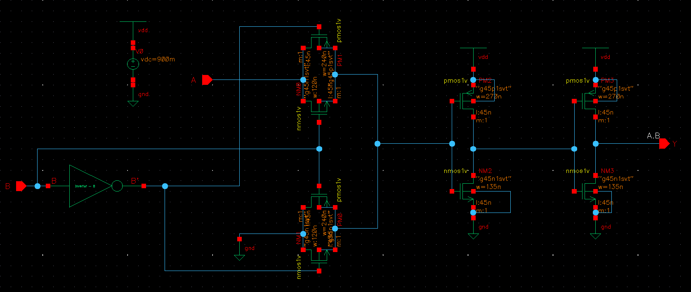
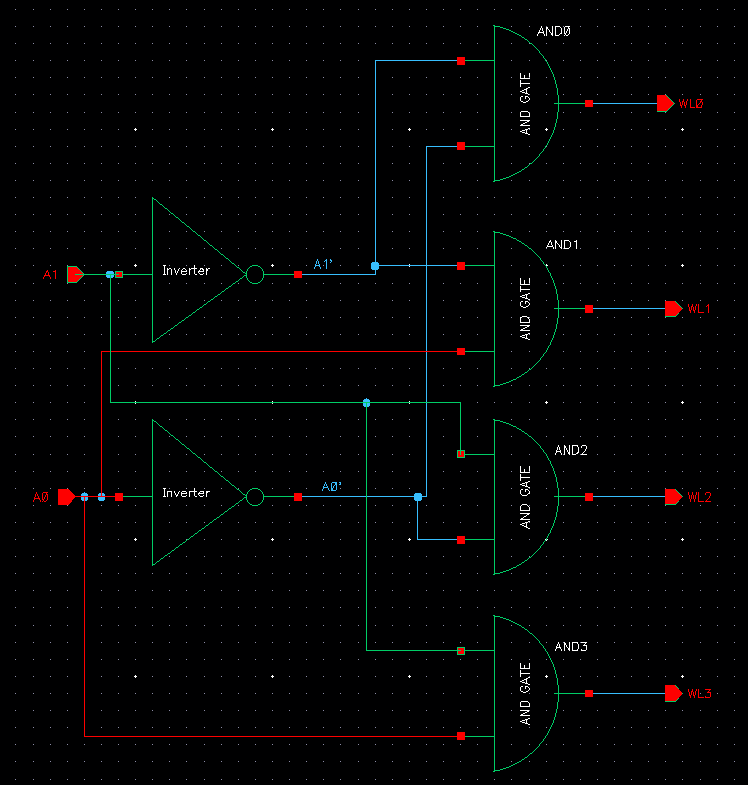
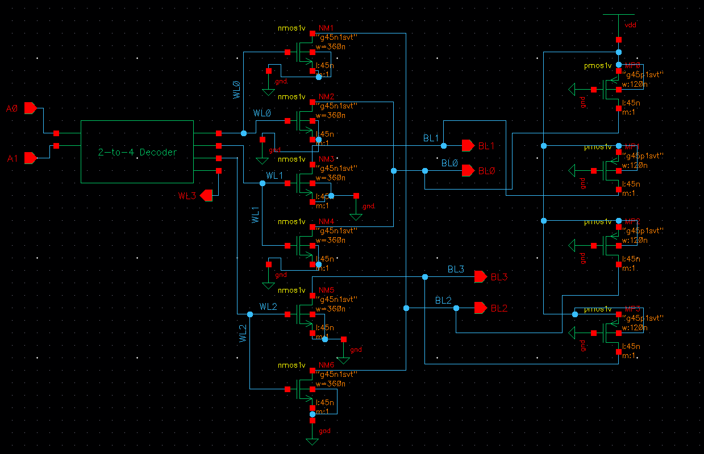

# Design and Full-Custom Implementation of a 4×4 NMOS Mask ROM Using Cadence Virtuoso (45 nm CMOS Technology)

## 1. Project Overview

This project documents the full-custom, transistor-level design of a 4-word × 4-bit NMOS mask ROM in Cadence Virtuoso using the gpdk045 (45 nm) CMOS technology. The memory was built bottom-up from a CMOS inverter, through a transmission-gate AND gate and a 2-to-4 address decoder, to a static, ratioed NMOS ROM array with PMOS pull-up loads.

The ROM is mask-programmed: the stored data is fixed by the presence or absence of NMOS transistors in the array. It is read-only and cannot be written during operation.


*Figure 1. Architecture: address inputs, 2-to-4 decoder, word lines WL0–WL3, NMOS ROM array, bit lines BL0–BL3, data outputs.*

```
4x4-NMOS-Mask-ROM/
├── README.md
├── images/
│   ├── architecture.png
│   ├── inverter.png
│   ├── transmission_gate_and.png
│   ├── decoder.png
│   ├── rom_array.png
│   ├── rom_array_tb.png
│   └── transient_waveforms.png
└── .gitignore
```

## 2. Technology and Design Tools

| Item | Detail |
|---|---|
| Technology | gpdk045 (45 nm CMOS) |
| Design entry | Cadence Virtuoso, transistor-level schematics |
| Simulation | Transient analysis in Cadence Virtuoso |
| Waveform viewing and measurement | Cadence ViVA |
| Supply voltage (ROM simulation) | V<sub>DD</sub> = 1 V |

## 3. Design Methodology

The 4×4 NMOS Mask ROM was implemented using a full-custom transistor-level design approach in Cadence Virtuoso with the gpdk045 (45 nm) technology.

The implementation was carried out through the following stages:

1. **CMOS Inverter Design:** Designed and verified a CMOS inverter through transient simulation. The inverter provides the complemented address signals required by the decoder.
2. **Transmission-Gate-Based AND Gate:** Designed an AND gate using transmission-gate logic and verified its functional behaviour through simulation.
3. **2-to-4 Address Decoder:** Integrated two CMOS inverters and four AND gates to construct an active-high 2-to-4 decoder. The decoder generates four word-line signals (WL0–WL3) based on the address inputs (A1, A0).
4. **NMOS ROM Array Implementation:** Designed a 4-word × 4-bit memory array using six NMOS pull-down transistors. The presence or absence of an NMOS transistor at each word-line and bit-line intersection determines the stored data.
5. **PMOS Pull-Up Integration:** Connected four always-on PMOS transistors, one to each bit line, to provide the pull-up paths required for static, ratioed ROM operation.
6. **Transistor Sizing Optimization:** Optimized the NMOS and PMOS transistor dimensions to improve the bit-line logic-LOW voltage and read behaviour.
7. **Transient Simulation and Timing Analysis:** Simulated the complete ROM in Cadence Virtuoso to verify the stored data across all four addresses. A preliminary address-to-output propagation delay was evaluated using Cadence ViVA.

## 4. CMOS Inverter

The inverter uses one PMOS and one NMOS with their gates tied to the input and their drains tied to the output. The PMOS source and bulk connect to V<sub>DD</sub>; the NMOS source and bulk connect to ground.

| Input | PMOS | NMOS | Output |
|---|---|---|---|
| 0 | ON, pulls output up | OFF | 1 |
| 1 | OFF | ON, pulls output down | 0 |

In each static state one transistor is off, so there is no direct path from V<sub>DD</sub> to ground and the output reaches the supply rails. Static current is limited to leakage. The inverter was verified by transient simulation with a pulsed input; the output is the logical complement of the input. In the decoder, two inverters generate A1̄ and Ā0.


## 5. Transmission-Gate AND Gate

A transmission gate (TG) is an NMOS and a PMOS connected in parallel, with the NMOS gate driven by a control signal C and the PMOS gate by its complement C̄. When C = 1 both devices conduct; when C = 0 both are off.

The two devices complement each other. An NMOS passes a strong 0 but a degraded 1 (about V<sub>DD</sub> − V<sub>TN</sub>), while a PMOS passes a strong 1 but a degraded 0 (about |V<sub>TP</sub>|). In parallel, the TG transfers the full logic range.

The AND function is realized as a selection:

$$F = A\cdot B = B\,A + \overline{B}\cdot 0$$

A TG controlled by B passes A to the output when B = 1; when B = 0 the output is held at logic 0 by the complementary path controlled by B̄, so F follows the AND truth table. The complement B̄ is obtained from an inverter. The gate was verified functionally in Cadence for all four input combinations.



*Figure 3. Transmission-gate AND gate schematic.*

Transmission-gate AND transistor dimensions are not recorded in the project documentation.

## 6. 2-to-4 Address Decoder

The decoder takes the address inputs A1 and A0 and drives the word lines WL0–WL3. Two inverters produce Ā1 and Ā0, and four AND gates (Section 5) form the minterms:

$$WL_0=\overline{A_1}\,\overline{A_0},\quad WL_1=\overline{A_1}A_0,\quad WL_2=A_1\overline{A_0},\quad WL_3=A_1A_0$$

| A1 | A0 | WL3 | WL2 | WL1 | WL0 |
|---|---|---|---|---|---|
| 0 | 0 | 0 | 0 | 0 | 1 |
| 0 | 1 | 0 | 0 | 1 | 0 |
| 1 | 0 | 0 | 1 | 0 | 0 |
| 1 | 1 | 1 | 0 | 0 | 0 |

The word lines are active-high and one-hot: exactly one is at logic 1 for every address. This is required by the array, because only one row of NMOS transistors may conduct at a time; two active rows would read two stored words onto the same bit lines simultaneously.



*Figure 4. 2-to-4 decoder schematic.*

Decoder transistor dimensions are not recorded in the project documentation.

## 7. 4×4 NMOS Mask ROM Architecture and Programming

| Parameter | Value |
|---|---|
| Words × bits per word | 4 × 4 |
| Address inputs | 2 (A1, A0) |
| Word lines / bit lines | 4 / 4 |
| Array crosspoints | 16 (4 word lines × 4 bit lines) |
| Crosspoints programmed with an NMOS | 6 |
| Pull-up loads | 4 PMOS, one per bit line |

The array is NOR-type. Word lines drive NMOS gates along the rows; each bit line (column) is tied to V<sub>DD</sub> through a PMOS load and to ground through whichever NMOS devices are placed on it.

**Programming by transistor presence.**

- An NMOS at (WLi, BLj) stores logic **0**: when WLi is high, it pulls BLj towards ground.
- No NMOS at (WLi, BLj) stores logic **1**: BLj is held high by the PMOS load.

**Stored data**

| Address (A1 A0) | BL3 | BL2 | BL1 | BL0 |
|---|:-:|:-:|:-:|:-:|
| 00 | 1 | 0 | 1 | 0 |
| 01 | 1 | 1 | 0 | 0 |
| 10 | 0 | 0 | 1 | 1 |
| 11 | 1 | 1 | 1 | 1 |

**NMOS programming map**

| Device | Gate | Drain | Source / Bulk | Stored zero |
|---|---|---|---|---|
| M1 | WL0 | BL2 | GND | Address 00, BL2 |
| M2 | WL0 | BL0 | GND | Address 00, BL0 |
| M3 | WL1 | BL1 | GND | Address 01, BL1 |
| M4 | WL1 | BL0 | GND | Address 01, BL0 |
| M5 | WL2 | BL3 | GND | Address 10, BL3 |
| M6 | WL2 | BL2 | GND | Address 10, BL2 |

WL3 has no NMOS devices because address 11 stores 1111.

**Read operation.** The address is applied, the decoder raises one word line, and the NMOS devices on that row discharge their bit lines. All other bit lines stay high. For address 00, WL0 is high and M1 and M2 pull BL2 and BL0 low while BL3 and BL1 remain high, giving 1010. For address 11, WL3 is high but its row has no NMOS devices, so all bit lines stay high, giving 1111. On unselected rows the word line is low and their NMOS devices are off.



*Figure 5. ROM array schematic.*

## 8. Transistor-Level Implementation: PMOS Pull-Ups and Ratioed Operation

**PMOS pull-up loads.**

| Device | Gate | Source | Drain | Bulk |
|---|---|---|---|---|
| MP0 | GND | V<sub>DD</sub> | BL0 | V<sub>DD</sub> |
| MP1 | GND | V<sub>DD</sub> | BL1 | V<sub>DD</sub> |
| MP2 | GND | V<sub>DD</sub> | BL2 | V<sub>DD</sub> |
| MP3 | GND | V<sub>DD</sub> | BL3 | V<sub>DD</sub> |

With the gate at ground and the source at V<sub>DD</sub>, each PMOS has V<sub>SG</sub> = V<sub>DD</sub>, which exceeds |V<sub>TP</sub>|, so it conducts continuously and behaves as a resistive load to V<sub>DD</sub>. When no NMOS is conducting, it holds the bit line high.

**NMOS pull-down.** When a word line is high, the NMOS devices on that row have V<sub>GS</sub> = V<sub>DD</sub> and sink current from their bit lines to ground.

**Ratioed logic.** Because the PMOS never turns off, a pulled-down bit line is a contest between the PMOS pull-up and the NMOS pull-down, and the bit line settles at a low level V<sub>OL</sub> above 0 V. To first order, with the NMOS in the triode region and the PMOS in saturation:

$$\mu_n C_{ox}\left(\frac{W}{L}\right)_n\left[(V_{DD}-V_{TN})V_{OL}-\frac{V_{OL}^2}{2}\right]\approx\frac{1}{2}\mu_p C_{ox}\left(\frac{W}{L}\right)_p\left(V_{DD}-|V_{TP}|\right)^2$$

This long-channel expression shows the trend only: a larger (W/L)<sub>n</sub>/(W/L)<sub>p</sub> gives a lower V<sub>OL</sub>. At 45 nm, short-channel effects mean the actual levels must come from simulation. Ratioed logic also draws static current from V<sub>DD</sub> through the PMOS and the conducting NMOS whenever a bit line is held low.

## 9. Transistor Sizing

**Final ROM array dimensions**

| Devices | Count | W | L | W/L |
|---|:-:|---|---|---|
| NMOS programming transistors M1–M6 | 6 | 360 nm | 45 nm | 8.0 |
| PMOS pull-up transistors MP0–MP3 | 4 | 120 nm | 45 nm | 2.67 |

Supply voltage: V<sub>DD</sub> = 1 V.

**Sizing iterations**

| Step | NMOS W/L | PMOS W/L | NMOS : PMOS |
|---|---|---|---|
| Initial | 240 nm / 45 nm | 240 nm / 45 nm | 1 : 1 |
| PMOS narrowed | 240 nm / 45 nm | 120 nm / 45 nm | 2 : 1 |
| **Final** | **360 nm / 45 nm** | **120 nm / 45 nm** | **3 : 1** |

With the initial equal widths, the output logic-low level was higher than desired because the always-on PMOS competed strongly with the selected NMOS. Narrowing the PMOS weakened the load, and widening the NMOS increased the pull-down current, both of which lower V<sub>OL</sub> (Section 8). The trade-offs are larger NMOS gate and drain capacitance on the word and bit lines, and a weaker PMOS for recharging a bit line when it returns to logic high. These effects were not quantified in this project.

## 10. Transient Simulation and Results

A ROM testbench was created in Cadence Virtuoso with V<sub>DD</sub> = 1 V. The address inputs A1 and A0 were stepped through the four addresses, and the word lines WL0–WL3 and bit lines BL0–BL3 were observed in a transient analysis.

**Observed behaviour**

- Each address change activates one word line.
- The bit lines respond with the programmed word for that address (Section 7); bit lines with an NMOS on the active row go to logic low and the others remain at logic high.
- The four programmed words were verified.
- With the initial equal-width sizing, the logic-low level was higher because of the PMOS/NMOS contention; the final 360 nm / 120 nm sizing improved it.

Numerical V<sub>OL</sub> and V<sub>OH</sub> values, power consumption and area were not characterized.


*Figure 6. Transient waveforms of the address inputs, word lines and bit lines.*


*Figure 7. Complete ROM schematic (decoder and array).*

## 11. Propagation Delay

One address-to-output transition was measured using Cadence ViVA at the 0.5 V level (50 % of V<sub>DD</sub>).

| Event | Time |
|---|---|
| A0 crosses 0.5 V | 15.01 ns |
| BL0 crosses 0.5 V | 15.29 ns |

$$t_{pd} = 15.29\ \mathrm{ns} - 15.01\ \mathrm{ns} = 0.28\ \mathrm{ns} = 280\ \mathrm{ps}$$

This is a **preliminary measurement of a single transition**. It is not the worst-case delay and not the final access time of the ROM. Other address transitions and bit lines were not characterized.

## 12. Conclusion

A 4×4 NMOS mask ROM was designed at transistor level in Cadence Virtuoso with the gpdk045 technology, progressing from a CMOS inverter and a transmission-gate AND gate to a 2-to-4 decoder and the complete array. The decoder selects one active-high word line per address, six NMOS transistors encode the stored zeros, and four always-on PMOS loads restore the stored ones. Transient simulation at V<sub>DD</sub> = 1 V confirmed the four programmed words.

The design illustrates the central trade-off of ratioed logic: the pull-up must be weak enough and the pull-down strong enough to give a usable logic-low level, at the cost of static current when a bit line is pulled low. The final ROM sizing is NMOS 360 nm / 45 nm and PMOS 120 nm / 45 nm, and a preliminary delay of 280 ps was measured for one transition.

**Not characterized:** numerical V<sub>OL</sub> and V<sub>OH</sub>, worst-case delay, power consumption and area. Physical layout and post-layout simulation are outside the scope of this document.
